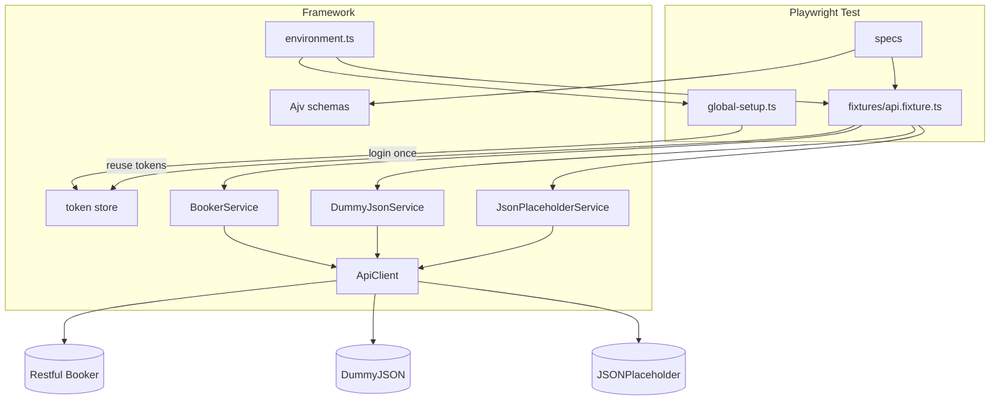
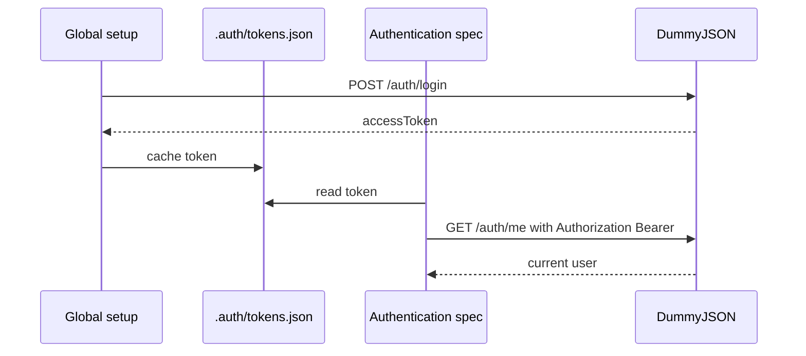
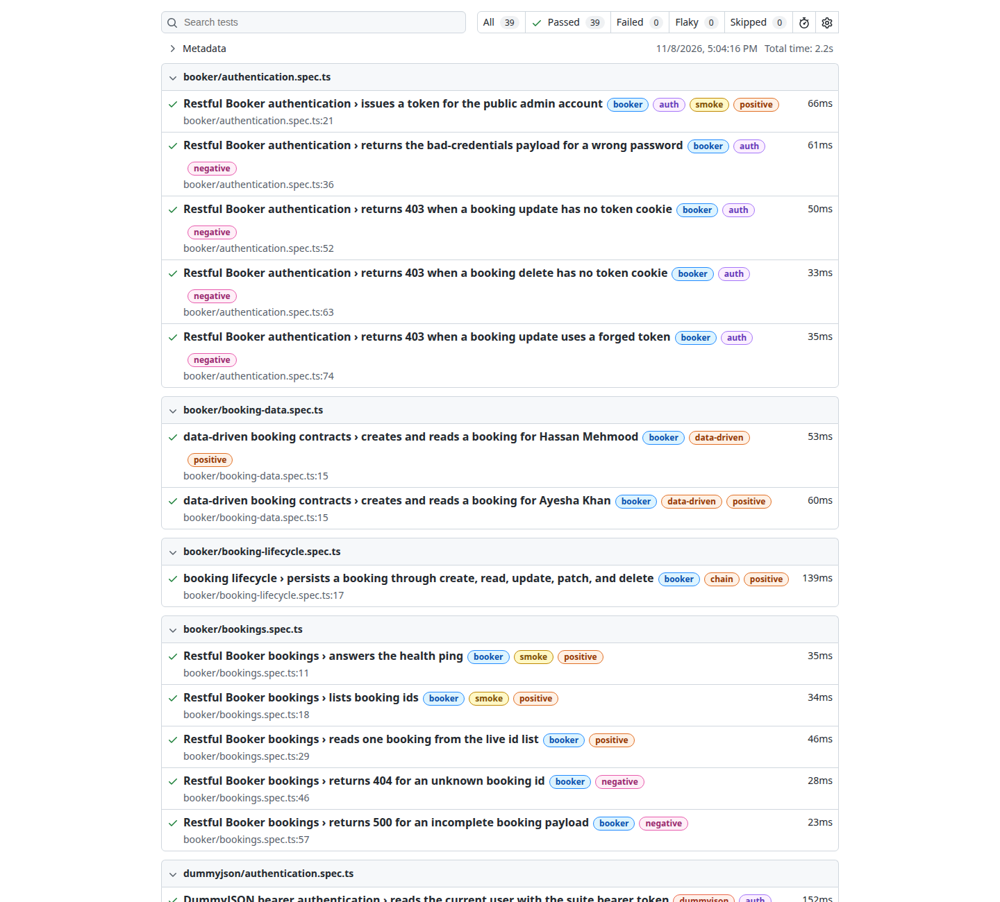

# Playwright API Automation

[](https://github.com/hassanmehmoodd/playwright-api-automation/actions/workflows/api-tests.yml)
[](https://nodejs.org/)
[](https://www.typescriptlang.org/)
[](https://playwright.dev/)
[](https://ajv.js.org/)
[](LICENSE)

TypeScript REST API automation framework built with Playwright Test and `APIRequestContext`. Specs run over HTTP, so the suite does not download or launch browsers. It checks public sandbox APIs with authenticated and anonymous clients, JSON Schema, data-driven cases, and a persisted create-read-update-delete flow.

The sandboxes under test:

| API                                                     | Role in the suite                                         |
| ------------------------------------------------------- | --------------------------------------------------------- |
| [Restful Booker](https://restful-booker.herokuapp.com)  | Token cookie, 403s, and the persisted booking lifecycle   |
| [DummyJSON](https://dummyjson.com)                      | Bearer JWT login, `/auth/me`, and product contracts       |
| [JSONPlaceholder](https://jsonplaceholder.typicode.com) | Stable read models, response headers, and write contracts |

ReqRes was checked on 8 November 2026. It responded without an API key, with a small per-minute limit and sponsorship fields in the payload. It is left out so the suite stays small and predictable.

## Architecture

Global setup logs in once. Fixtures read the cached tokens and hand each spec a service. Services call one host. `ApiClient` performs the HTTP call. Schemas live in `schemas/` and are compiled with Ajv.



Bearer reuse for DummyJSON:



Restful Booker issues an opaque token and expects it as `Cookie: token=...`. The same cache feeds that cookie. Writes on that host also send `Accept: application/json`.

## Folder structure

```text
├── .github/workflows/api-tests.yml   # CI: typecheck, lint, test, upload reports
├── fixtures/api.fixture.ts           # authenticated and anonymous services
├── global-setup.ts                   # one login per run
├── schemas/                          # JSON Schema contracts, one folder per API
├── scripts/render-sample-report.mjs  # writes docs/sample-report.md
├── src/
│   ├── auth/token-store.ts
│   ├── config/environment.ts
│   ├── domain/booking.ts
│   ├── http/api-client.ts
│   ├── services/                     # Booker, DummyJSON, JSONPlaceholder
│   └── validation/                   # Ajv wrapper and response assertions
├── test-data/                        # data-driven cases
├── tests/
│   ├── booker/
│   ├── dummyjson/
│   ├── jsonplaceholder/
│   ├── framework/                    # schema validator, no network
│   └── support/
├── playwright.config.ts
├── .env.example
└── docs/sample-report.md
```

## Features

| Feature                               | Where it lives                                                                                                                                                             |
| ------------------------------------- | -------------------------------------------------------------------------------------------------------------------------------------------------------------------------- |
| REST API automation                   | `src/http/api-client.ts`, `src/services/`, `tests/`                                                                                                                        |
| GET, POST, PUT, PATCH, DELETE         | `tests/booker/booking-lifecycle.spec.ts`, `tests/dummyjson/product-lifecycle.spec.ts`, `tests/jsonplaceholder/post-lifecycle.spec.ts`                                      |
| Authentication and authorization      | `tests/booker/authentication.spec.ts`, `tests/dummyjson/authentication.spec.ts`                                                                                            |
| Bearer token, fetched once and reused | `global-setup.ts`, `src/auth/token-store.ts`, `fixtures/api.fixture.ts`, `tests/dummyjson/authentication.spec.ts`                                                          |
| Response validation                   | `src/validation/assertions.ts` and every spec                                                                                                                              |
| JSON Schema validation                | `schemas/`, `src/validation/schema-validator.ts`, `tests/framework/schema-validator.spec.ts`                                                                               |
| Positive and negative scenarios       | tags `@positive` and `@negative` across `tests/`                                                                                                                           |
| Status code validation                | `expectStatus` in every API spec                                                                                                                                           |
| Header validation                     | `tests/jsonplaceholder/posts.spec.ts`, `tests/jsonplaceholder/post-lifecycle.spec.ts`, `tests/dummyjson/products.spec.ts`                                                  |
| Payload validation                    | lifecycle specs and `tests/booker/booking-data.spec.ts`                                                                                                                    |
| Chained API testing                   | `tests/booker/booking-lifecycle.spec.ts` (persisted), plus the DummyJSON and JSONPlaceholder lifecycle specs                                                               |
| Data-driven tests                     | `test-data/` with `tests/booker/booking-data.spec.ts`, `tests/dummyjson/authentication.spec.ts`, `tests/dummyjson/products.spec.ts`, `tests/jsonplaceholder/posts.spec.ts` |
| Environment configuration             | `.env.example`, `src/config/environment.ts`                                                                                                                                |
| Fixtures and service layer            | `fixtures/api.fixture.ts`, `src/services/`                                                                                                                                 |
| HTML, JUnit, and JSON reports         | `playwright.config.ts`                                                                                                                                                     |
| CI                                    | `.github/workflows/api-tests.yml`                                                                                                                                          |

## Sandbox contracts worth knowing

These are observed behaviors of the public hosts, and the specs assert them on purpose.

| Observation                                                                  | Assertion                                                                                   |
| ---------------------------------------------------------------------------- | ------------------------------------------------------------------------------------------- |
| Booker create returns HTTP 200                                               | lifecycle and data-driven create steps                                                      |
| Booker delete returns HTTP 201 and the text `Created`                        | booking lifecycle                                                                           |
| Booker bad credentials return HTTP 200 and `{ "reason": "Bad credentials" }` | authentication spec                                                                         |
| Booker update or delete without a valid token returns HTTP 403 `Forbidden`   | authentication spec                                                                         |
| Booker rejects an incomplete booking with HTTP 500                           | bookings spec                                                                               |
| DummyJSON missing or bad bearer tokens return HTTP 401                       | authentication spec                                                                         |
| DummyJSON and JSONPlaceholder writes are simulated                           | lifecycle specs check the response contract. Booker is the flow that reads the same id back |

GET requests retry HTTP 429, 500, 502, 503, and 504. POST, PUT, PATCH, and DELETE are not retried, so a retry cannot create a second resource. Assertion failures still include the URL and a redacted body. Schema failures list the JSON pointer and the Ajv message.

## Installation

Node.js 22 LTS (see `.nvmrc`). The suite uses `APIRequestContext`, so skip the browser download.

```bash
git clone https://github.com/hassanmehmoodd/playwright-api-automation.git
cd playwright-api-automation
PLAYWRIGHT_SKIP_BROWSER_DOWNLOAD=1 npm ci
cp .env.example .env
```

`.env` is optional. `src/config/environment.ts` already points at the public demo accounts published by Restful Booker (`admin` / `password123`) and DummyJSON (`emilys` / `emilyspass`). Copy `.env.example` when you want to override a base URL. Do not commit real credentials.

## Execution

```bash
npm test                      # full suite
npm run test:smoke            # @smoke
npm run test:auth             # @auth
npm run test:negative         # @negative
npm run test:chain            # @chain
npm run test:data             # @data-driven
npm run test:booker           # @booker
npm run test:dummyjson        # @dummyjson
npm run test:jsonplaceholder  # @jsonplaceholder
npm run typecheck
npm run lint
npm run format:check
```

Playwright grep also works: `npx playwright test --grep @auth tests/booker`.

Set `API_DEBUG=true` to log `METHOD url -> status` without response bodies.

CI retries a failed test twice because these sandboxes occasionally drop a connection. Local runs do not retry, so a red test is a real failure. Traces are kept locally on failure and turned off in CI, because a trace can contain a short-lived sandbox token. `test-results/` and `.auth/` are gitignored.

## Reporting

Every run writes:

| Report          | Path                   | Open it                         |
| --------------- | ---------------------- | ------------------------------- |
| Playwright HTML | `playwright-report/`   | `npm run report`                |
| JUnit XML       | `reports/junit.xml`    | any JUnit viewer or CI test tab |
| JSON            | `reports/results.json` | `npm run report:sample`         |

`npm run report:sample` rewrites [`docs/sample-report.md`](docs/sample-report.md) from `reports/results.json`. That page is a counted summary of a real local run. The HTML and JUnit outputs stay out of git because they include machine paths and timestamps.



## CI

[`.github/workflows/api-tests.yml`](.github/workflows/api-tests.yml) runs on push to `main`, on pull requests targeting `main`, and on `workflow_dispatch`.

- Concurrency group `api-tests-<workflow>-<ref>` with `cancel-in-progress`
- `actions/setup-node` caches npm
- `PLAYWRIGHT_SKIP_BROWSER_DOWNLOAD=1` so the job does not install browsers
- Typecheck, lint, format check, then the suite
- The job always uploads `playwright-report/`, `reports/`, and `test-results/` as the `api-test-reports` artifact (7 days)
- Job timeout is 15 minutes. Two workers on CI keep the sandbox traffic modest

No repository secrets are required.

## Author

**Hassan Mehmood** — Senior SQA Automation Engineer

- GitHub: [github.com/hassanmehmoodd](https://github.com/hassanmehmoodd)
- LinkedIn: [linkedin.com/in/hassan-mehmood-hm2](https://www.linkedin.com/in/hassan-mehmood-hm2/)

Licensed under the [MIT License](LICENSE). Copyright 2026 Hassan Mehmood.
